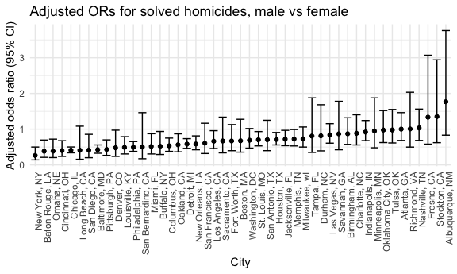
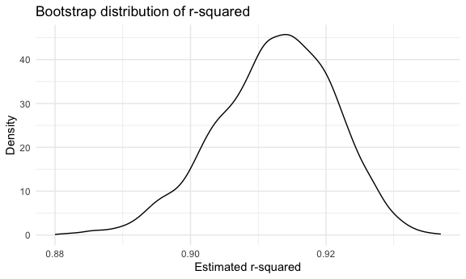
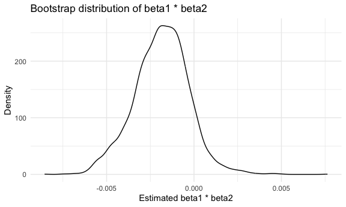

p8105_hw6_yc4959
================
Yimeng Cao
2026-11-24

## Problem 1

### Import and clean the data

I imported the homicide data, created `city_state` and a binary
`resolved` variable, and kept only victims whose race is White or Black.
I also removed Dallas, TX; Phoenix, AZ; Kansas City, MO; and Tulsa, AL.

``` r
homicide_df = 
  read_csv("data/homicide-data.csv") |> 
  mutate(
    city_state = str_c(city, ", ", state),
    resolved = as.numeric(disposition == "Closed by arrest"),
    victim_age = as.numeric(victim_age)) |> 
  filter(
    !(city_state %in% c("Dallas, TX", "Phoenix, AZ", "Kansas City, MO", "Tulsa, AL")),
    victim_race %in% c("White", "Black")) |> 
  mutate(victim_race = fct_relevel(victim_race, "White")) |> 
  select(city_state, resolved, victim_age, victim_race, victim_sex)
```

    ## Rows: 52179 Columns: 12
    ## ── Column specification ────────────────────────────────────────────────────────
    ## Delimiter: ","
    ## chr (9): uid, victim_last, victim_first, victim_race, victim_age, victim_sex...
    ## dbl (3): reported_date, lat, lon
    ## 
    ## ℹ Use `spec()` to retrieve the full column specification for this data.
    ## ℹ Specify the column types or set `show_col_types = FALSE` to quiet this message.

    ## Warning: There was 1 warning in `mutate()`.
    ## ℹ In argument: `victim_age = as.numeric(victim_age)`.
    ## Caused by warning:
    ## ! NAs introduced by coercion

### Fit a logistic regression for Baltimore

I fit a logistic regression for Baltimore, MD with resolved status as
the outcome and victim age, sex and race as predictors.

``` r
baltimore_fit = 
  homicide_df |> 
  filter(city_state == "Baltimore, MD") |> 
  glm(resolved ~ victim_age + victim_sex + victim_race, data = _, family = binomial())

baltimore_or = 
  baltimore_fit |> 
  broom::tidy() |> 
  mutate(
    OR = exp(estimate),
    ci_lower = exp(estimate - 1.96 * std.error),
    ci_upper = exp(estimate + 1.96 * std.error)) |> 
  filter(term == "victim_sexMale") |> 
  select(term, OR, ci_lower, ci_upper)

baltimore_or |> 
  knitr::kable(digits = 3)
```

| term           |    OR | ci_lower | ci_upper |
|:---------------|------:|---------:|---------:|
| victim_sexMale | 0.426 |    0.325 |    0.558 |

In Baltimore, the odds of solving a homicide with a male victim are 0.43
times the odds for a female victim, keeping age and race fixed. The 95%
confidence interval is (0.32, 0.56), which does not include 1.

### Fit a logistic regression for each city

I nested the data within cities, fit the same model in each city, and
extracted the adjusted odds ratio comparing male victims to female
victims.

``` r
city_results = 
  homicide_df |> 
  nest(data = -city_state) |> 
  mutate(
    models = map(data, \(df) glm(resolved ~ victim_age + victim_sex + victim_race, data = df, family = binomial())),
    results = map(models, broom::tidy)) |> 
  select(-data, -models) |> 
  unnest(results) |> 
  filter(term == "victim_sexMale") |> 
  mutate(
    OR = exp(estimate),
    ci_lower = exp(estimate - 1.96 * std.error),
    ci_upper = exp(estimate + 1.96 * std.error)) |> 
  select(city_state, OR, ci_lower, ci_upper)

city_results |> 
  knitr::kable(digits = 3)
```

| city_state         |    OR | ci_lower | ci_upper |
|:-------------------|------:|---------:|---------:|
| Albuquerque, NM    | 1.767 |    0.831 |    3.761 |
| Atlanta, GA        | 1.000 |    0.684 |    1.463 |
| Baltimore, MD      | 0.426 |    0.325 |    0.558 |
| Baton Rouge, LA    | 0.381 |    0.209 |    0.695 |
| Birmingham, AL     | 0.870 |    0.574 |    1.318 |
| Boston, MA         | 0.674 |    0.356 |    1.276 |
| Buffalo, NY        | 0.521 |    0.290 |    0.935 |
| Charlotte, NC      | 0.884 |    0.557 |    1.403 |
| Chicago, IL        | 0.410 |    0.336 |    0.501 |
| Cincinnati, OH     | 0.400 |    0.236 |    0.677 |
| Columbus, OH       | 0.532 |    0.378 |    0.750 |
| Denver, CO         | 0.479 |    0.236 |    0.971 |
| Detroit, MI        | 0.582 |    0.462 |    0.734 |
| Durham, NC         | 0.812 |    0.392 |    1.683 |
| Fort Worth, TX     | 0.669 |    0.397 |    1.127 |
| Fresno, CA         | 1.335 |    0.580 |    3.071 |
| Houston, TX        | 0.711 |    0.558 |    0.907 |
| Indianapolis, IN   | 0.919 |    0.679 |    1.242 |
| Jacksonville, FL   | 0.720 |    0.537 |    0.966 |
| Las Vegas, NV      | 0.837 |    0.608 |    1.154 |
| Long Beach, CA     | 0.410 |    0.156 |    1.082 |
| Los Angeles, CA    | 0.662 |    0.458 |    0.956 |
| Louisville, KY     | 0.491 |    0.305 |    0.790 |
| Memphis, TN        | 0.723 |    0.529 |    0.988 |
| Miami, FL          | 0.515 |    0.304 |    0.872 |
| Milwaukee, wI      | 0.727 |    0.499 |    1.060 |
| Minneapolis, MN    | 0.947 |    0.478 |    1.875 |
| Nashville, TN      | 1.034 |    0.685 |    1.562 |
| New Orleans, LA    | 0.585 |    0.422 |    0.811 |
| New York, NY       | 0.262 |    0.138 |    0.499 |
| Oakland, CA        | 0.563 |    0.365 |    0.868 |
| Oklahoma City, OK  | 0.974 |    0.624 |    1.520 |
| Omaha, NE          | 0.382 |    0.203 |    0.721 |
| Philadelphia, PA   | 0.496 |    0.378 |    0.652 |
| Pittsburgh, PA     | 0.431 |    0.265 |    0.700 |
| Richmond, VA       | 1.006 |    0.498 |    2.033 |
| San Antonio, TX    | 0.705 |    0.398 |    1.249 |
| Sacramento, CA     | 0.669 |    0.335 |    1.337 |
| Savannah, GA       | 0.867 |    0.422 |    1.780 |
| San Bernardino, CA | 0.500 |    0.171 |    1.462 |
| San Diego, CA      | 0.413 |    0.200 |    0.855 |
| San Francisco, CA  | 0.608 |    0.317 |    1.165 |
| St. Louis, MO      | 0.703 |    0.530 |    0.932 |
| Stockton, CA       | 1.352 |    0.621 |    2.942 |
| Tampa, FL          | 0.808 |    0.348 |    1.876 |
| Tulsa, OK          | 0.976 |    0.614 |    1.552 |
| Washington, DC     | 0.690 |    0.468 |    1.017 |

### Plot the odds ratios

``` r
city_results |> 
  mutate(city_state = fct_reorder(city_state, OR)) |> 
  ggplot(aes(x = city_state, y = OR)) + 
  geom_point() + 
  geom_errorbar(aes(ymin = ci_lower, ymax = ci_upper)) + 
  labs(
    title = "Adjusted ORs for solved homicides, male vs female",
    x = "City",
    y = "Adjusted odds ratio (95% CI)"
  ) + 
  theme(axis.text.x = element_text(angle = 90, hjust = 1))
```



Most cities have an estimated odds ratio below 1, so homicides with male
victims tend to be less likely to be solved than those with female
victims. New York has the lowest odds ratio, while Albuquerque has the
highest. Many of the confidence intervals include 1, especially for
smaller cities, so the difference is not significant in those cities.
The cities with odds ratios above 1, like Albuquerque, Stockton and
Fresno, all have very wide confidence intervals, so I would not trust
those estimates too much.

## Problem 2

### Draw bootstrap samples and fit models

I used the Central Park weather data and drew 5000 bootstrap samples.
For each sample, I fit a linear regression with `tmax` as the outcome
and `tmin` and `prcp` as predictors.

``` r
data("weather_df")

central_park_df = 
  weather_df |> 
  filter(name == "CentralPark_NY") |> 
  select(tmax, tmin, prcp)

boot_results = 
  central_park_df |> 
  modelr::bootstrap(n = 5000) |> 
  mutate(
    models = map(strap, \(df) lm(tmax ~ tmin + prcp, data = df)),
    glance = map(models, broom::glance),
    results = map(models, broom::tidy)) |> 
  select(-strap, -models)
```

### Extract the two quantities

I used `broom::glance()` to get r-squared and `broom::tidy()` to get the
coefficients for `tmin` and `prcp`.

``` r
r_squared_df = 
  boot_results |> 
  select(.id, glance) |> 
  unnest(glance) |> 
  select(.id, r_squared = r.squared)

beta_df = 
  boot_results |> 
  select(.id, results) |> 
  unnest(results) |> 
  filter(term %in% c("tmin", "prcp")) |> 
  select(.id, term, estimate) |> 
  pivot_wider(
    names_from = term, 
    values_from = estimate) |> 
  mutate(beta_product = tmin * prcp)
```

### Plot the distributions

``` r
r_squared_df |> 
  ggplot(aes(x = r_squared)) + 
  geom_density() + 
  labs(
    title = "Bootstrap distribution of r-squared",
    x = "Estimated r-squared",
    y = "Density"
  )
```



``` r
beta_df |> 
  ggplot(aes(x = beta_product)) + 
  geom_density() + 
  labs(
    title = "Bootstrap distribution of beta1 * beta2",
    x = "Estimated beta1 * beta2",
    y = "Density"
  )
```



The distribution of r-squared is roughly bell-shaped and centered around
0.91, with a slightly longer tail on the left. This means `tmin` and
`prcp` explain most of the variation in `tmax` across bootstrap samples.
The distribution of beta1 \* beta2 is also roughly bell-shaped, but it
is centered slightly below 0 with a longer tail on the left. This is
because the coefficient for `prcp` is very close to 0 and is usually
slightly negative.

### Construct confidence intervals

I used the 2.5% and 97.5% quantiles of the 5000 bootstrap estimates to
construct 95% confidence intervals.

``` r
r_squared_df |> 
  summarize(
    ci_lower = quantile(r_squared, 0.025),
    ci_upper = quantile(r_squared, 0.975)) |> 
  knitr::kable(digits = 3)
```

| ci_lower | ci_upper |
|---------:|---------:|
|    0.894 |    0.928 |

``` r
beta_df |> 
  summarize(
    ci_lower = quantile(beta_product, 0.025),
    ci_upper = quantile(beta_product, 0.975)) |> 
  knitr::kable(digits = 5)
```

| ci_lower | ci_upper |
|---------:|---------:|
| -0.00507 |  0.00117 |

The 95% confidence interval for r-squared is (0.894, 0.928), and the 95%
confidence interval for beta1 \* beta2 is (-0.00507, 0.00117).

## Problem 3

### Load and clean the data

I imported the birthweight data, converted the categorical variables to
factors, and checked for missing data.

``` r
birthweight_df = 
  read_csv("data/birthweight.csv") |> 
  janitor::clean_names() |> 
  mutate(
    babysex = case_match(babysex, 1 ~ "male", 2 ~ "female"),
    babysex = as.factor(babysex),
    frace = case_match(frace, 1 ~ "White", 2 ~ "Black", 3 ~ "Asian", 4 ~ "Puerto Rican", 8 ~ "Other", 9 ~ "Unknown"),
    frace = as.factor(frace),
    mrace = case_match(mrace, 1 ~ "White", 2 ~ "Black", 3 ~ "Asian", 4 ~ "Puerto Rican", 8 ~ "Other"),
    mrace = as.factor(mrace),
    malform = case_match(malform, 0 ~ "absent", 1 ~ "present"),
    malform = as.factor(malform))
```

    ## Rows: 4342 Columns: 20
    ## ── Column specification ────────────────────────────────────────────────────────
    ## Delimiter: ","
    ## dbl (20): babysex, bhead, blength, bwt, delwt, fincome, frace, gaweeks, malf...
    ## 
    ## ℹ Use `spec()` to retrieve the full column specification for this data.
    ## ℹ Specify the column types or set `show_col_types = FALSE` to quiet this message.

    ## Warning: There was 1 warning in `mutate()`.
    ## ℹ In argument: `babysex = case_match(babysex, 1 ~ "male", 2 ~ "female")`.
    ## Caused by warning:
    ## ! `case_match()` was deprecated in dplyr 1.2.0.
    ## ℹ Please use `recode_values()` instead.

There is no missing data in this dataset. I also noticed that `pnumlbw`
and `pnumsga` are 0 for every baby, so these two variables are not
useful as predictors.

### Propose a regression model

I chose variables that are known before birth and could affect
birthweight: gestational age, mother’s race, smoking, pre-pregnancy BMI,
weight gain, and baby’s sex. I left out head circumference and length
because they are measured at birth, just like birthweight.

``` r
proposed_model = 
  lm(bwt ~ gaweeks + mrace + smoken + ppbmi + wtgain + babysex, data = birthweight_df)

proposed_model |> 
  broom::tidy() |> 
  knitr::kable(digits = 3)
```

| term              | estimate | std.error | statistic | p.value |
|:------------------|---------:|----------:|----------:|--------:|
| (Intercept)       |  352.540 |   112.104 |     3.145 |   0.002 |
| gaweeks           |   54.104 |     2.121 |    25.506 |   0.000 |
| mraceBlack        | -170.939 |    66.313 |    -2.578 |   0.010 |
| mracePuerto Rican |  -60.002 |    71.109 |    -0.844 |   0.399 |
| mraceWhite        |  126.737 |    66.254 |     1.913 |   0.056 |
| smoken            |  -11.552 |     0.907 |   -12.739 |   0.000 |
| ppbmi             |   20.056 |     2.067 |     9.702 |   0.000 |
| wtgain            |    9.787 |     0.604 |    16.194 |   0.000 |
| babysexmale       |   85.144 |    13.008 |     6.545 |   0.000 |
